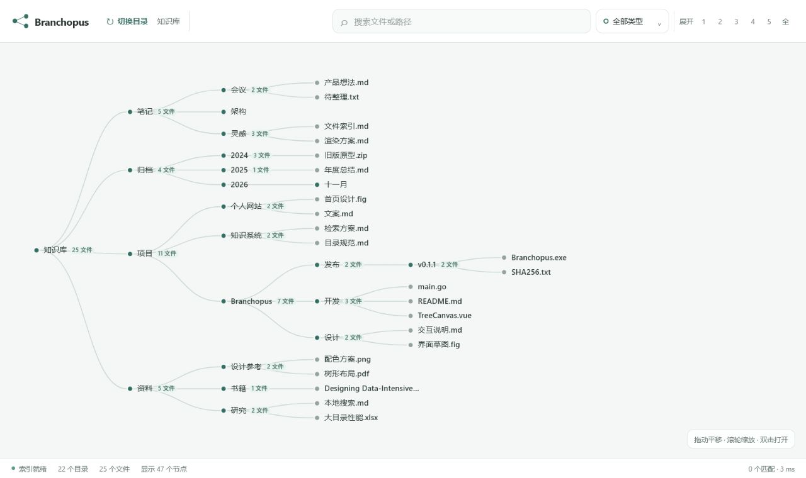

<div align="center">
  
  <h1>Branchopus</h1>
  <p>把本地文件夹展开成一棵真正的分叉树。</p>
  <p><strong>目录再深，也不用一层层翻。</strong></p>
  <p>
    <a href="https://github.com/StillQuery/branchopus/releases/latest"><strong>下载 Windows 版</strong></a>
    ·
    <a href="#使用方法">使用方法</a>
    ·
    <a href="#本地开发">本地开发</a>
  </p>
  <p>
    
    
    
  </p>
</div>


<div align="center">
  <sub>选择目录 → 建立索引 → 搜索只保留命中节点和必要路径</sub>
</div>

| 一眼看全目录 | 搜索干净 | 按类型筛选 | 本地运行 |
| --- | --- | --- | --- |
| 真正的分叉树，可拖动、缩放 | 只显示命中节点和路径 | Markdown、PDF、图片等可组合筛选 | 数据留在本机，无需安装 |

Branchopus 是一个轻量的 Windows 本地目录树查看器。它适合目录层级深、文件较多，又不想逐层打开资源管理器确认内容的场景。

<details>
<summary>查看完整界面</summary>



</details>

## 功能

- 使用分叉树展示完整目录结构，支持拖动平移和滚轮缩放。
- 按文件扩展名筛选，例如只看 Markdown、PDF 或图片。
- 按节点名称搜索，只保留命中节点以及通向它们的必要路径。
- 同一条路径上有多级命中时，以最深层命中为主，不展开无关子项。
- 通过一次性的 `1`–`5` 层或“全”按钮整理当前展开状态，之后仍可手动展开任意目录。
- 右键目录可以“仅查看该分支”或“以此作为根节点”；右键文件可以只保留该文件的完整路径。
- 任意节点都可以复制绝对路径或在文件管理器中打开；文件节点会在打开目录后自动选中文件。
- 大目录在 Go 内存索引中查询，Canvas 负责绘制，避免为每个节点创建 DOM 元素。
- 使用应用内目录选择器，避开大型目录下容易卡顿的 Windows Shell 选择框。

扫描范围是文件名、目录名、路径和扩展名；不会解析文件正文，也不会上传目录数据。

## 下载与运行

系统要求：Windows 10/11 x64，并安装 Microsoft Edge WebView2 Runtime。Windows 10/11 通常已自带 WebView2。

1. 打开 [Releases](https://github.com/StillQuery/branchopus/releases/latest)。
2. 下载 `Branchopus-v0.1.1-windows-x64.zip`。
3. 解压到任意纯英文路径，例如 `C:\Tools\Branchopus`。
4. 双击 `Branchopus.exe`，不需要安装或管理员权限。

当前发布包没有代码签名。Windows SmartScreen 可能在首次运行时提示未知发布者；请从本仓库 Release 下载，并用发布页提供的 SHA256 校验文件后再决定是否运行。

## 使用方法

### 1. 选择目录

点击“选择文件夹”，可以逐层浏览，也可以直接输入完整路径。确认后应用会建立内存索引，界面会显示扫描状态。

### 2. 浏览目录树

- 单击目录节点或文字：展开、收起目录。
- 双击节点：用系统默认程序打开文件或目录。
- 按住鼠标拖动：平移画布。
- 滚轮：以鼠标位置为中心缩放。

### 3. 搜索

搜索只匹配节点自身名称，不会因为上级目录名称命中而把所有后代都算作结果。

- 输入一个关键词：名称包含该关键词即命中，不区分大小写。
- 输入多个以空格分隔的关键词：同一个名称需要同时包含全部关键词。
- 目录和其后代同时命中：目录作为路径保留，以更深的命中节点为结果。
- 目录命中但后代没有再次命中：结果停在该目录，不展示无关子项。

### 4. 文件类型筛选

点击“全部类型”，选择一个或多个扩展名。类型筛选可以和名称搜索同时使用。

### 5. 整理与聚焦

- 顶部 `1`–`5` 和“全”是一次性展开命令，不会锁死层级。
- “仅查看该分支”保留当前根节点和通往所选节点的链路，同时隐藏旁支。
- “以此作为根节点”直接把所选目录提升为画布根节点。
- “在文件管理器中打开”会直接打开目录；对文件使用时会打开所在目录并选中该文件。
- “复制绝对路径”会把节点的完整路径写入系统剪贴板。

## 性能设计

- 首次选择目录时建立完整的名称与层级索引。
- 查询在 Go 内存结构中完成，不基于前端已展开缓存。
- 安全范围内自动展开完整结果；节点过多时优先保留完整的根到命中路径。
- Canvas 只绘制当前需要显示的节点和视口内线条。
- 大型直接子列表按批次补充，避免一次渲染阻塞界面。

## 本地开发

需要：

- Go 1.26+
- Node.js 22+
- Windows WebView2 Runtime

```powershell
git clone git@github.com:StillQuery/branchopus.git
cd branchopus

cd frontend
npm ci
cd ..

go test ./...
go run github.com/wailsapp/wails/v2/cmd/wails@v2.17.1 dev
```

生产构建：

```powershell
go run github.com/wailsapp/wails/v2/cmd/wails@v2.17.1 build
```

生成的程序位于 `build/bin/Branchopus.exe`。

## 技术栈

- [Go](https://go.dev/)：目录扫描、索引与查询。
- [Wails](https://wails.io/)：Windows 桌面封装与前后端桥接。
- [Vue 3](https://vuejs.org/) + TypeScript：界面状态和交互。
- Canvas 2D：分叉树布局与绘制。

## 许可证

[MIT License](LICENSE)
